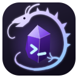
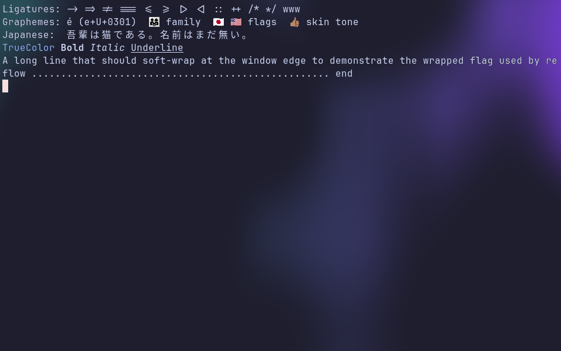

<div align="center">



# kuraokami

**軽量・高速・省電力、そしてアニメーションに全振りした GPU ターミナルエミュレーター**

Odin + SDL3 + OpenGL 3.3 + FreeType / HarfBuzz ・ バイナリ約 630 KB ・ アイドル時 CPU 0%

*A tiny, fast, power-friendly, animation-focused GPU terminal emulator written in Odin.*

</div>



<sub>テーマ `catppuccin-mocha` + シェーダー `builtin:aurora`。リガチャ（`->` `!=` `<=` …）、ZWJ 絵文字、国旗、日本語、ソフト折り返しを表示している様子。</sub>

---

## 目次

- [特徴](#特徴)
- [クイックスタート](#クイックスタート)
- [ビルド](#ビルド)
- [機能一覧](#機能一覧)
- [キーバインド](#キーバインド)
- [設定](#設定)
- [アニメーションとカスタムシェーダー](#アニメーションとカスタムシェーダー)
- [画像・動画の表示](#画像動画の表示)
- [パフォーマンス](#パフォーマンス)
- [アーキテクチャ](#アーキテクチャ)
- [テスト](#テスト)
- [既知の制限](#既知の制限)
- [ライセンスとクレジット](#ライセンスとクレジット)

---

## 特徴

| | |
|---|---|
| ⚡ **速い** | 50 MB のテキスト出力を約 0.84 秒で処理。描画は PTY 読み取りと並行して行うので、出力が詰まらない |
| 🪶 **軽い** | 単一バイナリ約 630 KB。外部ランタイムなし |
| 🔋 **省電力** | タイマーもポーリングもなし。何も起きていないときは完全にスリープ（カーソル点滅も 30 秒無操作で停止 → CPU 0）。アニメーションは動いている間だけ vsync で描画 |
| ✨ **アニメーション** | カーソルのスライドと残像、フェード点滅、スムーススクロール、タブのスライド、Ghostty 互換カスタムシェーダー |
| 🖼️ **画像・動画** | Kitty graphics protocol（`mpv --vo=kitty` で動画再生）と Sixel |
| 🇯🇵 **日本語** | IME インライン変換、全角幅、フォント自動フォールバック、カラー絵文字、書記素クラスタ |
| 🖥️ **起動時 fastfetch** | 最初のタブで fastfetch を表示してからシェルへ |

## クイックスタート

```sh
git clone https://github.com/TatsuyaM2667/kuraokami.git
cd kuraokami
./build.sh       # ビルド
./install.sh     # ~/.local にバイナリ・アプリランチャー(.desktop)・アイコンを導入
kuraokami        # またはアプリランチャーから「kuraokami」
```

アンインストールは `./uninstall.sh`。`PREFIX=/usr/local ./install.sh` のようにインストール先も変えられます。

```sh
kuraokami -e htop     # コマンドを直接起動
kuraokami --version
```

## ビルド

### 必要なもの

| | Linux | macOS | Windows |
|---|---|---|---|
| コンパイラ | [Odin](https://odin-lang.org/)（dev-2026-08 で確認）、gcc/clang | Odin、clang | Odin、MSVC |
| ライブラリ | SDL3, freetype2, harfbuzz, fontconfig, zlib, OpenGL 3.3 | Homebrew: `sdl3 freetype harfbuzz fontconfig pkg-config` | vcpkg: `freetype harfbuzz zlib`（SDL3.dll は Odin 同梱） |
| 手順 | `./build.sh` | `./build.sh` | Developer Prompt で `build.bat` |

```sh
./build.sh          # release (-o:speed)
./build.sh debug    # デバッグビルド
```

ビルドは C シム（`csrc/shim.c`）を静的ライブラリにしてから Odin 本体をリンクします。

> **注意:** 動作確認済みなのは Linux（Wayland / X11）だけです。macOS / Windows は型チェックと C シムのクロスコンパイルまでしか確認していません（PR 歓迎）。

## 機能一覧

### ターミナルの基本
- xterm 互換の VT パーサー: 256 色 / TrueColor（`;` と `:` の両形式）、太字・斜体・下線・取消線・反転・dim・非表示
- 代替画面、スクロール領域、行・文字の挿入削除、DEC 罫線文字セット、タブストップ、DECSCUSR（カーソル形状）
- **リフロー**: リサイズするとソフト折り返し行を再計算（全角文字は行をまたがない、カーソル位置追従）
- **書記素クラスタ**: 結合文字（é）、ZWJ 絵文字（👨‍👩‍👧）、国旗（🇯🇵）、肌色修飾（👍🏽）
- **リガチャ**: HarfBuzz によるシェーピング（`->` `=>` `!=` `===` など）
- スクロールバック（既定 10,000 行）、**スクロールバック検索**（全一致ハイライト・件数表示）
- **Kitty キーボードプロトコル**（disambiguate / イベント種別 / 全キーエスケープ / 関連テキスト）
- マウス: 文字・単語（ダブル）・行（トリプル、折り返し行ごと）選択、copy-on-select、中クリック貼り付け、Ctrl+クリックで URL / OSC 8 リンクを開く、マウスレポート（1000/1002/1003/SGR 1006）
- ブラケットペースト（貼り付け文字列中の ESC は除去）、フォーカスレポート、同期出力（2026）、DECRQM、XTVERSION、DA1/DA2、CSI 14/16/18 t

### ウィンドウ・UI
- タブと分割ペイン（新規タブ・ペインは今いるディレクトリを引き継ぐ）
- 分割境界の**マウスドラッグ**、キーボードでのリサイズ・均等化
- IME のインライン変換表示、ファイルのドラッグ&ドロップでパスを貼り付け
- 背景透過、HiDPI、フルスクリーン、ベル時のウィンドウ点滅と画面フラッシュ
- **設定のホットリロード**（保存した瞬間に反映。エラーは画面下にトースト表示）

### シェル連携（OSC）
| OSC | 内容 |
|---|---|
| 0 / 2 | ウィンドウ・タブのタイトル |
| 4 / 104, 10 / 11 / 12 | パレットと前景・背景・カーソル色の設定と問い合わせ（nvim の背景検出に対応） |
| 7 | カレントディレクトリ（新規タブ・ペインが継承） |
| 8 | ハイパーリンク（Ctrl+クリックで開く） |
| 9 / 777 | デスクトップ通知（Linux: notify-send、macOS: osascript） |
| 52 | クリップボードへの書き込み（**読み取りはプライバシーのため拒否**） |
| 133 | プロンプト位置の記録 → Ctrl+Shift+↑/↓ でプロンプト間ジャンプ |

## キーバインド

すべて設定ファイルで変更できます（[設定](#キーバインドの変更)）。

| キー | 動作 |
|---|---|
| `Ctrl+Shift+C` / `Ctrl+Shift+V` | コピー / 貼り付け |
| `Shift+Insert` | PRIMARY 選択を貼り付け |
| `Ctrl+Shift+A` | 全選択 |
| `Ctrl+Shift+T` / `Ctrl+Shift+W` | 新規タブ / ペイン（最後ならタブ）を閉じる |
| `Ctrl+Shift+E` / `Ctrl+Shift+O` | 右に分割 / 下に分割 |
| `Ctrl+Alt+矢印` | ペイン間の移動 |
| `Ctrl+Shift+Alt+矢印` / `Ctrl+Shift+Alt+=` | 分割サイズ変更 / 均等化 |
| `Ctrl+Tab` / `Ctrl+Shift+Tab`, `Ctrl+Shift+←/→` | 次 / 前のタブ |
| `Ctrl+Shift+1`…`9` | タブ番号へ移動 |
| `Shift+PgUp/PgDn`, `Ctrl+Shift+Home/End` | スクロール |
| `Ctrl+Shift+↑/↓` | 前 / 次のプロンプトへ（OSC 133） |
| `Ctrl+Shift+F` | 検索（`Enter` 古い方へ、`Shift+Enter` 新しい方へ、`Esc` で閉じる） |
| `Ctrl+Shift+K` | スクロールバックを消去 |
| `Ctrl+=` / `Ctrl+-` / `Ctrl+0` | フォントサイズ 拡大 / 縮小 / 元に戻す |
| `Ctrl+Shift+,` / `Ctrl+Shift+R` | 設定ファイルを開く / 再読み込み |
| `F11` | フルスクリーン |
| タブバーを中クリック | タブを閉じる |

macOS では `Cmd+C` / `Cmd+V` / `Cmd+T` / `Cmd+W` / `Cmd+D` なども使えます。

## 設定

設定ファイル: `~/.config/kuraokami/config`（`$XDG_CONFIG_HOME` を優先、Windows は `%APPDATA%\kuraokami\config`）。
`Ctrl+Shift+,` で開くと、ファイルがなければサンプル入りで作られます。書式は `キー = 値` で、`#` 以降はコメントです。

```ini
theme = tokyonight
font-family = JetBrainsMono Nerd Font Mono
font-size = 12
background-opacity = 0.92
custom-shader = builtin:aurora
keybind = ctrl+shift+d=split_right
```

### 全設定項目

| キー | 既定値 | 説明 |
|---|---|---|
| `theme` | — | 組込テーマ名、または `~/.config/kuraokami/themes/<名前>` |
| `font-family` | `monospace` | fontconfig のファミリ名（Windows は `C:\Windows\Fonts` 内のファイル名） |
| `font-size` | `12` | ポイント |
| `font-ligatures` | `true` | リガチャの有効・無効 |
| `foreground` / `background` | `#c5c8c6` / `#1d1f21` | 文字色 / 背景色 |
| `cursor-color` | `#c5c8c6` | カーソル色 |
| `selection-background` | `#373b41` | 選択範囲の色 |
| `palette` | — | `palette = N=#rrggbb`（N は 0〜15） |
| `background-opacity` | `1` | 0〜1。透過の有無の切り替えは再起動後に反映 |
| `cursor-style` | `block` | `block` / `underline` / `bar` |
| `cursor-blink` | `true` | フェード点滅（30 秒無操作で停止） |
| `cursor-trail` | `true` | カーソルのスライドと残像 |
| `smooth-scroll` | `true` | スムーススクロール |
| `visual-bell` | `true` | ベル時の画面フラッシュ |
| `animation` | `true` | `false` ですべてのアニメーションを停止 |
| `custom-shader` | — | `builtin:aurora` / `builtin:crt` / `builtin:cursor-glow` / `.glsl` ファイルのパス |
| `custom-shader-animation` | `true` | フォーカス中は毎フレーム描画（省電力優先なら `false`） |
| `startup-fetch` | `true` | 起動時に fastfetch を実行 |
| `fetch-command` | `fastfetch` | 起動時に実行するコマンド |
| `command` | `$SHELL` | 起動するシェル |
| `scrollback-limit` | `10000` | スクロールバック行数 |
| `window-padding` | `4` | ペイン内の余白（px） |
| `copy-on-select` | `true` | 選択したら PRIMARY にコピー |
| `keybind` | — | 下記参照（複数行で指定可） |

### 組込テーマ

`tokyonight` ・ `catppuccin-mocha` ・ `dracula` ・ `gruvbox-dark` ・ `nord` ・ `solarized-dark`

自作テーマは `~/.config/kuraokami/themes/<名前>` に、設定ファイルと同じ書式（`background`、`foreground`、`palette` など）で置きます。
`theme =` の後に書いた色指定はテーマより優先されます。

### キーバインドの変更

```ini
keybind = ctrl+shift+d=split_right   # 追加・上書き
keybind = alt+1=goto_tab:1           # 引数付きのアクション
keybind = ctrl+shift+t=unbind        # 既定のバインドを解除
keybind = clear                      # 既定のバインドを全部消す
```

修飾キー: `ctrl` `shift` `alt` `super`（`cmd` / `win` も可）。キー名は SDL のキー名に加えて `enter` `esc` `equal` `minus` `comma` `pgup` `pgdn` などが使えます。

**アクション一覧:**
`copy` `paste` `paste_selection` `select_all` `new_tab` `close_pane` `split_right` `split_down`
`focus_left` `focus_right` `focus_up` `focus_down` `next_tab` `prev_tab` `goto_tab:N`
`resize_left` `resize_right` `resize_up` `resize_down` `equalize_splits`
`scroll_page_up` `scroll_page_down` `scroll_top` `scroll_bottom` `prompt_prev` `prompt_next`
`font_inc` `font_dec` `font_reset` `open_config` `reload_config` `search` `clear_scrollback`
`toggle_fullscreen` `unbind`

## アニメーションとカスタムシェーダー

**内蔵のアニメーション:** カーソルのスライドと残像、フェード点滅、スムーススクロール（タッチパッドの細かいスクロール量にも追従）、タブのスライドと下線の移動、起動時のフェードイン、ビジュアルベル、トースト通知のスライド。

いずれも**動いている間だけ**描画し、止まったら完全にスリープします。

### カスタムシェーダー

[Ghostty](https://ghostty.org/) / shadertoy 互換の `mainImage` 形式の GLSL を読み込めます。ターミナルの描画結果が `iChannel0` に入ります。

```glsl
void mainImage(out vec4 fragColor, in vec2 fragCoord) {
    vec2 uv = fragCoord / iResolution.xy;
    vec4 term = texture(iChannel0, uv);
    fragColor = vec4(term.rgb * (0.9 + 0.1 * sin(iTime)), term.a);
}
```

使えるユニフォーム: `iResolution` `iTime` `iTimeDelta` `iFrame` `iMouse` `iChannel0` `iCurrentCursor` `iPreviousCursor` `iCurrentCursorColor` `iPreviousCursorColor` `iTimeCursorChange`
（カーソルは `vec4(x, y, 幅, 高さ)`。y はウィンドウ下端からの上辺の位置）

内蔵: `builtin:aurora`（背景にゆらめくオーロラ）、`builtin:crt`（ブラウン管風の湾曲・走査線・色ずれ）、`builtin:cursor-glow`（カーソルが光り、移動時にパルス）。

## 画像・動画の表示

- **Kitty graphics protocol**: RGB / RGBA / PNG、直接転送・ファイル・一時ファイル・共有メモリ、zlib 圧縮、分割転送、配置・削除・z-index
  ```sh
  mpv --vo=kitty --really-quiet video.mp4   # ターミナル内で動画を再生
  kitten icat image.png
  ```
- **Sixel**: `img2sixel`、`chafa -f sixels` など

## パフォーマンス

Linux（AMD Ryzen 7 7735HS / Radeon 680M、Wayland）での実測値:

| 項目 | 結果 |
|---|---|
| 50 MB（40 万行、色・日本語混じり）の `cat` | **約 0.84 秒** |
| パーサー単体 | 約 63 MB/秒 |
| アイドル時 CPU（点滅停止後） | **0 tick / 5 秒** |
| メモリ（RSS） | 約 94 MB（大半は Mesa の GL ドライバと fontconfig のキャッシュ） |
| バイナリサイズ | 約 630 KB |

省電力と速さのための工夫:
- イベントを待つ間はブロックし、タイマーもポーリングもしない
- 描画時はロック中に表示範囲だけをコピーし、シェーピングと描画はロックの外で行う（PTY の読み取りを止めない）
- ASCII 専用の高速パス、HarfBuzz の結果キャッシュ、英数字だけの語はシェーピングを省略
- 設定監視は inotify（Linux）で、待っている間は CPU を使わない

## アーキテクチャ

```
src/
├── main.odin              アプリ本体: イベントループ、タブ・分割、入力、選択、検索、アニメーション
├── term.odin              VT パーサー、画面バッファ（リングバッファ）、リフロー、書記素、Kitty キーボード、検索
├── render.odin            フォントアトラス、HarfBuzz シェーピング、OpenGL 描画、ポストエフェクト、内蔵シェーダー
├── graphics.odin          Kitty graphics protocol、Sixel デコーダー
├── keys.odin              キーバインド、Kitty キーボードプロトコルのエンコード
├── config.odin            設定パーサー、組込テーマ
├── width.odin             文字幅テーブル（East Asian Wide / 絵文字 / 結合文字）
├── platform_unix.odin     forkpty、Linux / macOS 固有の処理
├── platform_windows.odin  ConPTY
├── watch_linux.odin       inotify による設定のホットリロード
└── term_test.odin         テスト
csrc/shim.c                FreeType / HarfBuzz / fontconfig / stb_image / zlib の薄い C ラッパー
assets/                    アイコン、.desktop、スクリーンショット
```

- **スレッド構成:** PTY ごとに読み取りスレッドが 1 本あり、パースして端末状態を更新します。描画は UI スレッドで行い、状態のコピー中だけロックを取ります。
- **C シムを挟む理由:** FreeType / HarfBuzz の構造体レイアウトを Odin 側で再現しないで済むよう、平坦な C ABI だけを公開しています。

## テスト

```sh
odin test src -extra-linker-flags:"-L$(pwd)/lib"
```

パーサー、折り返しとスクロール、全角文字、代替画面とスクロール領域、リサイズ、リフロー、書記素クラスタ、Kitty graphics と Sixel、OSC、Kitty キーボードプロトコル、キーバインドと設定の読み込み、検索をカバーしています。

デバッグ用: 環境変数 `KURAOKAMI_SHOT=/path/out.ppm` を付けて起動すると、毎フレームを PPM 画像に書き出します（GUI の自動確認用）。

## 既知の制限

- macOS / Windows は実機未検証です（型チェックと C シムのクロスコンパイルは通っています）。Windows はデスクトップ通知と Kitty の共有メモリ転送に未対応です。
- `background-opacity` で透過の有無を切り替えたときは、反映に再起動が必要です。
- 英数字だけの語は HarfBuzz を通さないため、`www` のような英字だけのリガチャは出ません（速度優先）。
- 閉じたペインの端末状態はメモリを解放しません（読み取りスレッドとの競合を避けるため）。
- 起動時の fastfetch は Unix 系のみです。

## ライセンスとクレジット

本体のライセンスはまだ決めていません（追加予定）。

使用ライブラリ:
- [SDL3](https://libsdl.org/)（zlib License）
- [FreeType](https://freetype.org/)（FTL / GPLv2）
- [HarfBuzz](https://harfbuzz.github.io/)（MIT）
- [fontconfig](https://www.freedesktop.org/wiki/Software/fontconfig/)（MIT 系）
- [zlib](https://zlib.net/)（zlib License）
- [stb_image](https://github.com/nothings/stb)（Public Domain / MIT、`csrc/stb_image.h` に同梱）

内蔵テーマの配色は [Tokyo Night](https://github.com/folke/tokyonight.nvim)、[Catppuccin](https://github.com/catppuccin/catppuccin)、[Dracula](https://draculatheme.com/)、[Gruvbox](https://github.com/morhetz/gruvbox)、[Nord](https://www.nordtheme.com/)、[Solarized](https://ethanschoonover.com/solarized/) に基づいています。
